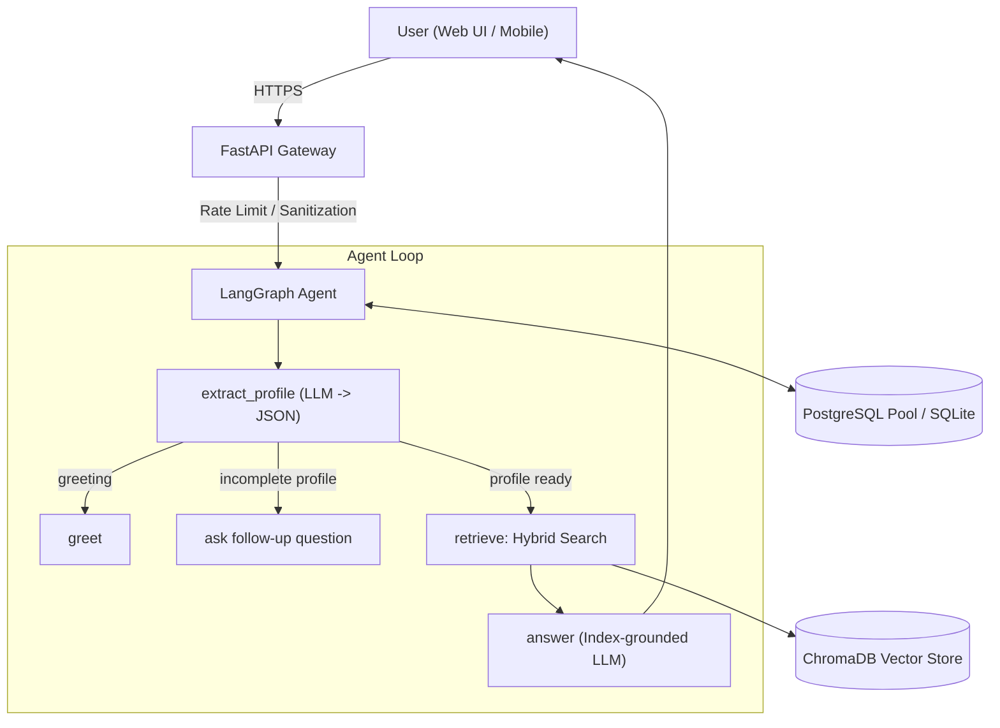

# YojanaSaathi 🇮🇳

**A production-ready AI agent that helps Indian citizens discover government welfare schemes in simple Hinglish.**

A user describes their situation in plain language (*"Main 25 saal ka hoon, rehri lagata hoon, loan milega?"*). The agent asks for any missing details (age, occupation, income) through conversational slot-filling, searches a curated scheme database via hybrid retrieval, and answers with relevant schemes and verified **official source links**.

> **Live Demo on Render:** https://yojana-saathi-fb30.onrender.com  
> *(Hosted on Render free tier — initial wake-up may take ~45s if idle)*

---

## Production Features

- **Conversational Slot-Filling:** Built with LangGraph StateGraph — requests age, occupation, and income only when needed.
- **20 Central Government Schemes:** PM-Kisan, Ayushman Bharat PM-JAY, PM SVANidhi, PM Mudra, Sukanya Samriddhi, Atal Pension (APY), PM Vishwakarma, e-Shram, NSP Scholarships, Stand-Up India, PMAY, PMFBY, PMSBY (Accident Insurance), PMJJBY (Life Insurance), PMMVY (Maternity Benefit), PM-SYM (Labour Pension), IGNOAPS (Old Age Pension), PM Jan Dhan, and PM Ujjwala.
- **Hybrid Retrieval (Vector + Keyword):** ChromaDB semantic vector search combined with Hinglish token matching so colloquial terms (*kisan, fasal kharab, rehri, patri, mazdoor*) surface the correct schemes.
- **100% Free LLM Resilience:** Zero-cost architecture powered by Groq API.
  - Multi-key rotation (`GROQ_API_KEYS=key1,key2`) for double/triple token quotas.
  - Automatic fallback between active models (`openai/gpt-oss-20b` ➔ `openai/gpt-oss-120b` ➔ `qwen/qwen3.8-27b`).
  - Adaptive backoff on HTTP 429 rate limits.
- **API Security & Rate Limiting:**
  - `slowapi` IP-based rate limiting (25 requests/minute per client).
  - Pydantic v2 request validation (min 1, max 600 characters) and prompt injection mitigation.
  - CORS middleware for secure cross-origin browser access.
- **Persistent Storage with Connection Pooling:**
  - PostgreSQL support with `psycopg_pool.ConnectionPool` for Render Managed Postgres.
  - Graceful fallback to local SQLite for local development.
- **Observability & Health Checks:**
  - Liveness probe at `/health`.
  - Deep readiness probe at `/healthz` verifying database connectivity and ChromaDB index readiness.
  - Graceful fallback responses on upstream overload (no raw 500 tracebacks).
- **Hardened Containerization & Deployment:**
  - Non-root user (`appuser`), bytecode pre-compilation, and Docker container healthchecks.
  - Infrastructure-as-Code with `render.yaml` for 1-click Render deployment.
- **100-Question Evaluation Suite:**
  - Automated evaluation harness with resumption support, multi-turn testing, and strict negative filtering.

---

## Architecture



---

## Tech Stack

| Layer | Technology |
|---|---|
| **Backend & API** | FastAPI, Uvicorn, SlowAPI, Pydantic v2 |
| **Agent Framework** | LangGraph (StateGraph) |
| **LLM Inference** | Groq (`openai/gpt-oss-20b`, `openai/gpt-oss-120b`, `qwen/qwen3.8-27b`) |
| **Retrieval (RAG)** | ChromaDB (Vector) + Keyword token overlap |
| **Database** | PostgreSQL (`psycopg` + `psycopg_pool`) / SQLite |
| **Deployment** | Docker, Render Blueprint (`render.yaml`) |
| **Frontend** | HTML5, Tailwind CSS, Vanilla JavaScript |

---

## Evaluation Benchmark

The project includes an automated eval runner (`evals/runs_eval.py`) across a **100-question test suite** (`evals/test_questions.json`):

| Category | Count | Description |
|---|---|---|
| **In-Scope Profile Queries** | 40 | Realistic citizen queries with complete/partial profiles |
| **Direct Scheme Questions** | 18 | Direct inquiries (*"Ayushman card kaise banta hai?"*) |
| **Out-of-Scope Guardrails** | 13 | Negative tests (*"Crypto", "Train ticket", "Tractor advice"*) |
| **Missing Info Clarifications** | 9 | Ambiguous queries requiring slot-filling (*"Mujhe yojana chahiye"*) |
| **Multi-Turn Slot-Filling** | 8 | Conversational multi-turn dialogues |
| **English & Bilingual Queries** | 12 | Mixed Hinglish & English questions |

Run the eval suite:

```bash
# Run all tests (resumable on rate limits)
python -m evals.runs_eval --resume

# Run specific IDs
python -m evals.runs_eval --ids 15,16,26,27,97
```

---

## Local Development

### 1. Clone & Setup Virtual Environment

```bash
git clone https://github.com/<your-username>/yojana-saathi.git
cd yojana-saathi
python -m venv venv
venv\Scripts\activate          # Windows PowerShell / CMD
# source venv/bin/activate     # Mac / Linux
pip install -r requirements.txt
```

### 2. Configure Environment

```bash
cp .env.example .env
```
Edit `.env`:
```ini
GROQ_API_KEY=gsk_your_groq_api_key_here
# Optional: Multiple keys for free rotation:
# GROQ_API_KEYS=gsk_key1,gsk_key2
```

### 3. Ingest Scheme Data & Start Server

```bash
python -m app.rag.ingest
uvicorn app.main:app --reload
```

Open **http://127.0.0.1:8000** in your browser.

---

## Deployment on Render

### Option A: Using Render Blueprint (`render.yaml`)
1. Push your repository to GitHub.
2. In the [Render Dashboard](https://dashboard.render.com), click **New +** ➔ **Blueprint**.
3. Select this repository. Render will automatically detect `render.yaml` and configure the Docker service with `/healthz` healthchecks.
4. Set the `GROQ_API_KEY` secret in your service settings.

### Option B: Docker Container
```bash
docker build -t yojana-saathi .
docker run -p 8000:8000 --env-file .env yojana-saathi
```

---

## API Documentation

### `POST /ask`
Submit a question to the conversational agent.

```json
{
  "question": "Main 25 saal ka hoon, thela lagata hoon, loan milega?",
  "session_id": "session-101"
}
```

**Response (HTTP 200):**
```json
{
  "answer": "PM SVANidhi: Street vendors ke liye bina guarantee loan milta hai...",
  "profile": {
    "age": 25,
    "occupation": "street vendor"
  },
  "sources": [
    {
      "name": "PM SVANidhi (Rehri-Patri Loan)",
      "url": "https://pmsvanidhi.mohua.gov.in"
    }
  ]
}
```

### Other Endpoints:
- `GET /health` — Basic service liveness check.
- `GET /healthz` — Deep readiness probe (checks database and vector store health).
- `GET /history/{session_id}` — Fetch conversation chat history.

---

## Environment Variables

| Variable | Required | Description |
|---|---|---|
| `GROQ_API_KEY` | Yes | Primary Groq API Key |
| `GROQ_API_KEYS` | No | Comma-separated Groq API keys for automated rotation |
| `GROQ_MODEL` | No | Primary model ID (default: `openai/gpt-oss-20b`) |
| `DATABASE_URL` | No | PostgreSQL connection URL (e.g. Render Postgres) |
| `ALLOWED_ORIGINS`| No | CORS allowed origins (default: `*`) |

---

## Disclaimer

YojanaSaathi provides general informational assistance and is not an official government portal. Users must verify official guidelines, required documentation, and deadlines on official government websites before applying.

---

Built with pride by **Ishwar Dhakad**.
